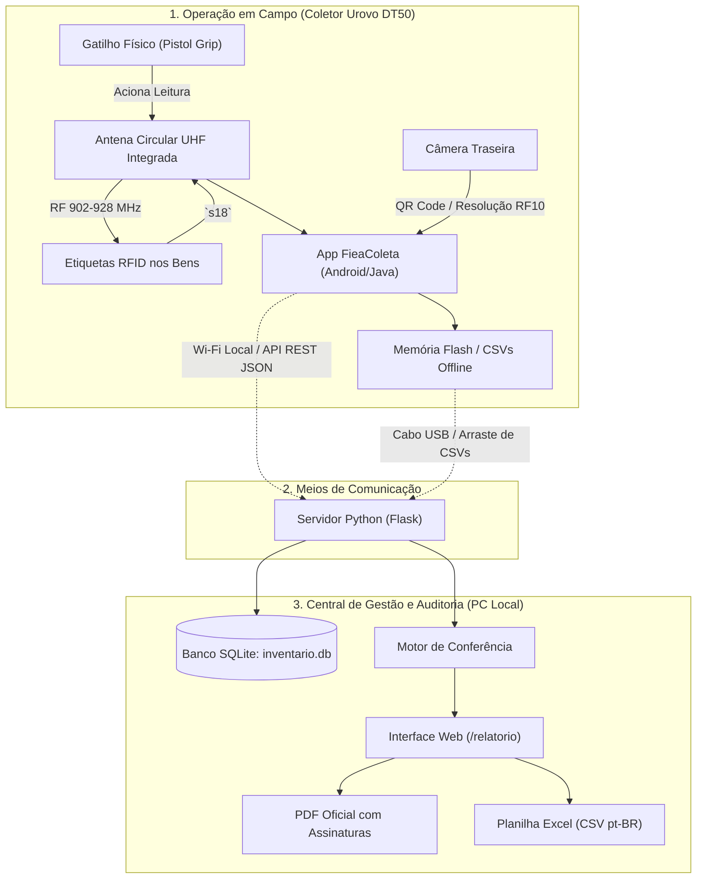

# FIEA Coleta RFID — Sistema de Inventário e Auditoria Patrimonial

## Sumário
1. [Visão Geral do Projeto](#visão-geral-do-projeto)
2. [Arquitetura da Solução](#arquitetura-da-solução)
3. [Funcionalidades Entregues](#funcionalidades-entregues)
4. [Estrutura do Repositório](#estrutura-do-repositório)
5. [Tecnologias Utilizadas](#tecnologias-utilizadas)
6. [Como Operar o Sistema (Passo a Passo)](#como-operar-o-sistema-passo-a-passo)
7. [Métricas e Resultados de Bancada](#métricas-e-resultados-de-bancada)
8. [Limitações do MVP e Próximos Passos](#limitações-do-mvp-e-próximos-passos)

---

## Visão Geral do Projeto

Os processos tradicionais de controle patrimonial são lentos, manuais e suscetíveis a falhas humanas, exigindo que operadores procurem plaqueta por plaqueta com linha direta de visão.

O **FIEA Coleta RFID** substitui esse processo por uma **auditoria ágil por radiofrequência (RFID UHF)**:
* O operador entra em uma sala com o coletor portátil, aciona o gatilho e lê **dezenas de bens por segundo à distância**, sem precisar tocar ou ver a etiqueta diretamente.
* O sistema identifica instantaneamente se o bem está na **sala correta**, se foi **transferido indevidamente** para outro local ou se está **desaparecido/faltante**.
* Funciona tanto **conectado via Wi-Fi** quanto **100% offline**, permitindo auditorias em galpões, laboratórios ou salas sem sinal de internet.

---

## Arquitetura da Solução

O sistema opera em uma **arquitetura híbrida (Edge + On-Premise)** dividida em dois componentes principais:



### Componentes:
1. **Dispositivo de Campo (Urovo DT50 UHF):** Coletor móvel industrial com sistema Android, antena RFID integrada e leitor óptico para QR Code.
2. **Servidor Local (Computador do Gestor):** Aplicação Python com banco de dados SQLite que opera na rede local da empresa, sem necessidade de servidores externos ou nuvem.

---

## Funcionalidades Entregues

### 1. Gestão Centralizada de Salas e Bens
* **Gerenciamento de Salas (`/salas`):** Cadastro e exclusão de ambientes vinculados à unidade correspondente.
* **Cadastro de Bens (`/`):** Formulário ágil com seleção de sala via menu suspenso (*dropdown*), eliminando digitações redundantes.

### 2. Ponte de Rádio para Cadastro Rápido (Bancada)
* Ao cadastrar um bem no PC, clique em **"📡 Capturar do Urovo"**; no coletor, na aba **Etiquetagem**, toque em **Transmitir** e encoste a etiqueta no leitor.
* Durante a captura, o app reduz a potência do rádio para 5 dBm (e restaura a original em seguida) para ler **apenas a etiqueta em foco**, sem ler itens vizinhos, e preenche o código EPC no formulário do computador.
* Em campo, sem o PC, a mesma aba grava cada vínculo EPC ↔ patrimônio em um arquivo `etiquetagem_*.csv` no coletor (**Salvar vínculo**).

### 3. Varredura Rápida de Campo (Inventário)
* **Inventário por unidade:** a unidade é escolhida numa lista vinda do PC e a sessão mostra todas as salas dela, com quantas já foram varridas. O operador varre sala por sala até completar a unidade.
* Operação com gatilho físico lendo dezenas de tags por segundo.
* **Deduplicação Inteligente (RF06):** Consolida centenas de leituras brutas em registros únicos por etiqueta, gravando a contagem de respostas, a intensidade do sinal (**RSSI**) e as janelas de horário.

### 4. Monitoramento Visual de Conexão Wi-Fi
* Indicador visual em tempo real em ambas as pontas:
  * No coletor: selo na barra superior com `Conectado` ou `Offline` e a quantidade de envios na fila. Um toque nele, ou na engrenagem ao lado, abre o endereço do PC.
  * No navegador: badge com indicador pulsante `🟢 Coletor Conectado` ou `⚪ Aguardando Wi-Fi`.

### 5. Tratamento de Pendências em Campo
* Bens esperados na sala que não responderam ao rádio aparecem na aba **Pendências**, no topo da lista, com barra de progresso e contagem por situação.
* O operador pode resolver o item diretamente na sala através de 3 botões:
  1. **Ler QR** pela câmera (para etiquetas híbridas danificadas no chip);
  2. **Manual** (conferindo a plaqueta visualmente e confirmando o tombo);
  3. **Faltante** (o bem foi procurado e não está na sala).

### 6. Importação Offline Descomplicada ("Arrasta e Solta")
* Se a coleta for feita sem Wi-Fi, o coletor gera arquivos `.csv` na pasta `XLSFile` do armazenamento interno.
* O operador não precisa entender a nomenclatura dos arquivos: basta plugar o cabo USB, selecionar todos os arquivos e **arrastá-los de uma só vez** para a área de importação na página web. O sistema identifica o conteúdo interno e processa tudo automaticamente (os `etiquetagem_*.csv` ainda são exceção; veja as [limitações](#limitações-do-mvp-e-próximos-passos)).

### 7. Central de Auditoria e Relatórios (`/relatorio`)
* **Painel Executivo de Indicadores (KPIs):**
  * 🟢 **Localizados:** Bens encontrados na sala correta com taxa de acurácia (%).
  * 🟡 **Fora do Local:** Bens encontrados em sala diferente da esperada (transferência indevida).
  * 🔴 **Não Localizados:** Bens esperados na sala que não responderam ao inventário.
  * ⚪ **Sem Cobertura:** Bens de salas que ainda não foram varridas.
  * 🔵 **Tags Sobrando:** Etiquetas lidas no ambiente que não possuem cadastro patrimonial.
* **Filtros Dinâmicos e Busca Instantânea:** Localize itens em segundos por patrimônio, descrição ou sala.

### 8. Exportações Oficiais
* **Planilha Excel / CSV:** Arquivo formatado em UTF-8 com BOM e separador ponto-e-vírgula (`;`), abrindo diretamente no Excel sem quebras de acentuação ou colunas.
* **PDF Oficial de Auditoria:** Impressão formatada em padrão A4, paginação contínua e bloco de assinaturas para o Operador e a Comissão de Inventário.

### 9. Interface do Coletor
* Identidade visual FIEA (logo, cores e ícone do app **FIEA**), com as mesmas cores de situação do relatório web.
* Navegação inferior com três abas: **Inventário**, **Pendências** e **Etiquetagem**. Em cada passo, a tela mostra só os campos e botões que fazem sentido.
* Desenhada a partir das 10 heurísticas de Nielsen para uso em campo: botões de 48 dp (uso com luva e uma mão na empunhadura), textos em português com instruções nas mensagens de erro, confirmação antes de encerrar a sessão e suporte a fonte grande e ao leitor de tela (TalkBack).
* **Área de desenvolvedor:** um toque longo no título da barra superior abre as ferramentas do demo da Urovo (Localizar, Ler/Gravar, Máscara e Parâmetros do rádio), escondidas do operador.

---

## Estrutura do Repositório

```text
fiea-mvp/
│
├── UHF_Demo/                       # Projeto Android Nativo (Coletor Urovo DT50)
│   ├── app/
│   │   ├── src/main/java/com/rfid/demo/
│   │   │   ├── MainActivity.java          # Barra superior, navegação inferior e área de desenvolvedor
│   │   │   ├── ScanActivity.java          # Inventário: sessão, varredura RFID e gatilho
│   │   │   ├── TagsSalaActivity.java      # Pendências: conferência e resolução (QR, manual, faltante)
│   │   │   ├── EtiquetagemActivity.java   # Vínculo EPC ↔ patrimônio e ponte de rádio de baixa potência
│   │   │   └── utils/SyncManager.java     # Gerenciador de sincronização REST e cache offline
│   │   ├── src/main/res/                  # Telas (layouts) e identidade visual FIEA (cores, estilos, ícones)
│   │   └── build/outputs/apk/debug/
│   │       └── FieaColeta_v2.5.<aaaaMMddHHmm>.apk   # APK compilado e pronto para uso
│
├── inventario/                     # Módulo do Servidor Local e Banco de Dados (Python)
│   ├── dados/
│   │   └── inventario.db           # Banco de dados relacional SQLite
│   ├── inventario/
│   │   ├── servidor.py             # Servidor Web (Flask), API REST e páginas HTML
│   │   ├── conferencia.py          # Algoritmo de cruzamento e auditoria
│   │   ├── importador.py           # Ingestão e validação de coletas offline
│   │   ├── etiquetagem.py          # Importação dos vínculos EPC ↔ patrimônio (RF03)
│   │   ├── leitor_csv.py           # Parser de cabeçalhos e deduplicação de leituras
│   │   └── esquema.py              # Tabelas do banco de dados SQLite
│   └── requirements.txt            # Dependências Python necessárias
│
└── README.md                       # Documentação principal do projeto
```

---

## Tecnologias Utilizadas

| Camada | Tecnologia / Ferramenta | Finalidade |
|---|---|---|
| **Dispositivo Móvel** | Java / Android 8.0+ (API 26) | Aplicativo nativo de alta performance no Urovo DT50 |
| **Interface do Coletor** | Material Components 1.6.1 | Botões, cards e navegação com a identidade visual FIEA |
| **Rádio RFID** | Urovo UHF SDK (`com.ubx.usdk.rfid`) | Controle do módulo de transmissão/recepção EPC Gen2 |
| **Óptico** | ZXing Android Embedded | Leitura de código de barras e QR Code pela câmera |
| **Servidor Local** | Python 3.10+ / Flask 3.1 | Servidor web leve e endpoints de sincronização REST |
| **Banco de Dados** | SQLite 3 | Armazenamento relacional local, com histórico permanente |
| **Interface Web** | HTML5 / Bootstrap 5.3 / CSS Print | Painel responsivo e folha de estilo oficial para PDF |

---

## Como Operar o Sistema (Passo a Passo)

### Passo 1: Cadastro das Salas e Bens (no PC)
1. Acesse `http://localhost:5000/salas` e cadastre as salas da unidade (ex: `EASY`, `Almoxarifado`, `Lab 1`).
2. Acesse `http://localhost:5000` e cadastre os bens patrimoniais associando cada um à sua sala correspondente.
3. Para gravar a etiqueta de cada bem, clique em **📡 Capturar do Urovo** no formulário e, no coletor, toque em **Transmitir** na aba **Etiquetagem**, encostando a etiqueta no leitor.

### Passo 2: Varredura com o Coletor Urovo DT50
1. Abra o app **FIEA** no coletor. Na primeira vez, toque na engrenagem da barra superior e informe o endereço do PC (ex: `192.168.1.100:5000`).
2. Na aba **Inventário**, escolha a **Unidade** na lista (ela vem das salas cadastradas no PC), preencha o **Operador** e toque em **Iniciar sessão**. Se o coletor nunca se conectou ao PC, a unidade é digitada, exatamente como está cadastrada.
3. A tela passa a mostrar as **salas da unidade**, com as que faltam no topo e o progresso "X de Y salas varridas". Escolha a **Técnica** e toque na sala em que você está para abrir a varredura dela.
4. Segure o **gatilho físico** e caminhe pela sala apontando o coletor para os bens. Um toque rápido no gatilho deixa a leitura contínua; outro toque para.
5. Toque em **Encerrar**. O app confere os bens da sala, volta à lista de salas (a sala aparece como varrida) e, se houver pendências, pergunta se você quer resolvê-las agora. Repita os passos 3 a 5 em cada sala.
6. Com as salas varridas, toque em **Encerrar sessão**. Se ainda faltar alguma, o app avisa antes: os bens dela aparecem no relatório como **Sem Cobertura**.

### Passo 3: Tratamento de Pendências (Opcional, em Campo)
1. Toque em **Resolver agora** ou abra a aba **Pendências**. Os bens que não responderam ao RFID aparecem no topo da lista.
2. Toque no bem e escolha uma das ações:
   * **Ler QR:** Aponte a câmera para a etiqueta do bem.
   * **Manual:** Confira a plaqueta e confirme o número do tombo.
   * **Faltante:** Registre que o bem foi procurado e não se encontra na sala.

### Passo 4: Sincronização e Geração do Relatório
* **Via Wi-Fi:** Na aba **Pendências**, toque em **Sincronizar**. Sem conexão, os dados ficam na fila do coletor, e o app oferece o envio quando a conexão voltar.
* **Via Cabo USB (Modo Offline):**
  1. Na aba **Inventário**, toque em **Encerrar sessão** e confirme.
  2. Conecte o cabo USB do coletor ao PC e abra a pasta `XLSFile` do armazenamento interno.
  3. No computador, acesse `http://localhost:5000/relatorio`.
  4. Arraste todos os arquivos `.csv` para a área pontilhada da tela e clique em **Processar Arquivos Selecionados**.

### Passo 5: Exportação dos Resultados
Na página `http://localhost:5000/relatorio`:
* Clique em **📥 Baixar CSV / Excel** para salvar a planilha de auditoria.
* Clique em **🖨️ Exportar PDF / Imprimir** para salvar o documento oficial formatado para assinatura.

---

## Métricas e Resultados de Bancada

Durante os ensaios práticos de bancada e campo para homologação do Marco 2, foram aferidos os seguintes resultados:

* **Taxa de Leitura e Deduplicação:**  
  Em uma varredura estática de 16 segundos na sala piloto `EASY`, foram capturadas **292 leituras brutas**, consolidadas automaticamente em **63 tags RFID distintas** (~18,25 leituras brutas/segundo), sem travamentos.
* **Potência de Rádio e Alcance Útil:**  
  * Em **30 dBm (Varredura):** Leitura consistente a até 4,5 metros de distância.
  * Em **10 dBm (Cadastro de Bancada):** Leitura delimitada a ~15 cm, permitindo etiquetar itens lado a lado sem contaminação de sinal.
* **Eficácia na Detecção de Leitura Cruzada:**  
  Um item deliberadamente cadastrado na sala `IC` foi lido na varredura da sala `EASY`. O motor de conferência classificou-o na hora como `FORA DO LOCAL` e emitiu o diagnóstico: *"Transferência indevida: esperado em 'IC', mas detectado em 'EASY'"*.

---

## Limitações do MVP e Próximos Passos

* **Vínculos gravados em campo:** os `etiquetagem_*.csv` gerados por **Salvar vínculo** ainda não são aceitos na importação da página `/relatorio` nem enviados pelo Wi-Fi. Hoje eles entram pela linha de comando, dentro da pasta `inventario`: `python -m inventario etiquetagem <arquivo>`. Próximo passo: aceitá-los na importação web ou enviá-los na hora, com fila offline.
* **Checagem dos vínculos:** o coletor só barra EPC ou patrimônio repetido dentro da mesma campanha. A conferência contra a base inteira (patrimônio fora da relação, EPC já usado em outro bem) acontece na importação.
* **Conferência manual:** o app aceita o número digitado sem compará-lo com o patrimônio do bem selecionado. Próximo passo: validar essa digitação.
