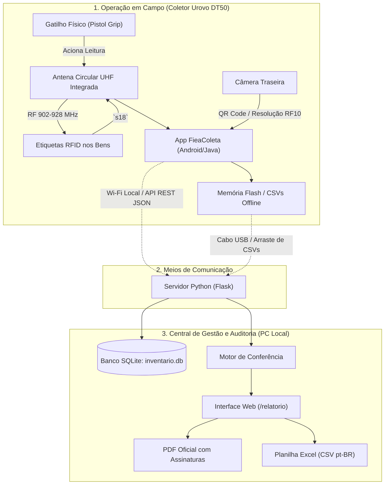

#  FIEA Coleta RFID — Sistema de Inventário e Auditoria Patrimonial

##  Sumário
1. [Visão Geral do Projeto](#-visão-geral-do-projeto)
2. [Arquitetura da Solução](#-arquitetura-da-solução)
3. [Funcionalidades Entregues no Marco 2](#-funcionalidades-entregues-no-marco-2)
4. [Estrutura do Repositório](#-estrutura-do-repositório)
5. [Tecnologias Utilizadas](#-tecnologias-utilizadas)
6. [Como Operar o Sistema (Passo a Passo)](#-como-operar-o-sistema-passo-a-passo)
7. [Métricas e Resultados de Bancada (Testes Marco 2)](#-métricas-e-resultados-de-bancada-testes-marco-2)
8. [Limitações do MVP e Próximos Passos](#-limitações-do-mvp-e-próximos-passos)

---

##  Visão Geral do Projeto

Os processos tradicionais de controle patrimonial são lentos, manuais e suscetíveis a falhas humanas, exigindo que operadores procurem plaqueta por plaqueta com linha direta de visão.

O **FIEA Coleta RFID** substitui esse processo por uma **auditoria ágil por radiofrequência (RFID UHF)**:
* O operador entra em uma sala com o coletor portátil, aciona o gatilho e lê **dezenas de bens por segundo à distância**, sem precisar tocar ou ver a etiqueta diretamente.
* O sistema identifica instantaneamente se o bem está na **sala correta**, se foi **transferido indevidamente** para outro local ou se está **desaparecido/faltante**.
* Funciona tanto **conectado via Wi-Fi** quanto **100% offline**, permitindo auditorias em galpões, laboratórios ou salas sem sinal de internet.

---

## Arquitetura da Solução

O sistema opera em uma **arquitetura híbrida (Edge + On-Premise)** dividida em dois componentes principais:



### Componentes:
1. **Dispositivo de Campo (Urovo DT50 UHF):** Coletor móvel industrial com sistema Android, antena RFID integrada e leitor óptico para QR Code.
2. **Servidor Local (Computador do Gestor):** Aplicação Python com banco de dados SQLite que opera na rede local da empresa, sem necessidade de servidores externos ou nuvem.

---

## Funcionalidades Entregues

### 1. Gestão Centralizada de Salas e Bens
* **Gerenciamento de Salas (`/salas`):** Cadastro e exclusão de ambientes vinculados à unidade correspondente.
* **Cadastro de Bens (`/`):** Formulário ágil com seleção de sala via menu suspenso (*dropdown*), eliminando digitações redundantes.

### 2. Ponte de Rádio para Cadastro Rápido (Bancada)
* Ao cadastrar um novo bem no PC, basta aproximar o Urovo da etiqueta e clicar em **"Capturar do Urovo"**.
* O app reduz a potência do rádio automaticamente (10 dBm) para ler **apenas a etiqueta em foco** (sem ler itens vizinhos), preenchendo o código EPC no formulário do computador instantaneamente.

### 3. Varredura Rápida de Campo (Scan)
* Operação com gatilho físico lendo dezenas de tags por segundo.
* **Deduplicação Inteligente (RF06):** Consolida centenas de leituras brutas em registros únicos por etiqueta, gravando a contagem de respostas, a intensidade do sinal (**RSSI**) e as janelas de horário.

### 4. Monitoramento Visual de Conexão Wi-Fi
* Indicador visual em tempo real em ambas as pontas:
  * No coletor: barra superior fixa com `🟢 Conectado ao PC` ou `🔴 Sem Conexão`.
  * No navegador: badge com indicador pulsante `🟢 Coletor Conectado` ou `⚪ Aguardando Wi-Fi`.

### 5. Tratamento de Pendências em Campo
* Bens esperados na sala que não responderam ao rádio aparecem na aba **Pendências**.
* O operador pode resolver o item diretamente na sala através de 3 opções:
  1. **Ler QR Code pela Câmera** (para etiquetas híbridas danificadas no chip);
  2. **Conferência Manual** (conferindo a plaqueta visualmente e confirmando o tombo);
  3. **Marcar como Item Faltante / Desaparecido**.

### 6. Importação Offline Descomplicada ("Arrasta e Solta")
* Se a coleta for feita sem Wi-Fi, o coletor gera arquivos `.csv` organizados na pasta `Download/FieaColeta`.
* O operador não precisa entender a nomenclatura dos arquivos: basta plugar o cabo USB, selecionar todos os arquivos e **arrastá-los de uma só vez** para a área de importação na página web. O sistema identifica o conteúdo interno e processa tudo automaticamente.

### 7. Central de Auditoria e Relatórios (`/relatorio`)
* **Painel Executivo de Indicadores (KPIs):**
  * 🟢 **Localizados:** Bens encontrados na sala correta com taxa de acurácia (%).
  * 🟡 **Fora do Local:** Bens encontrados em sala diferente da esperada (transferência indevida).
  * 🔴 **Não Localizados:** Bens esperados na sala que não responderam ao inventário.
  * ⚪ **Sem Cobertura:** Bens de salas que ainda não foram varridas.
  * 🔵 **Tags Sobrando:** Etiquetas lidas no ambiente que não possuem cadastro patrimonial.
* **Filtros Dinâmicos e Busca Instantânea:** Localize itens em segundos por patrimônio, descrição ou sala.

### 8. Exportações Oficiais
* **Planilha Excel / CSV:** Arquivo formatado em UTF-8 com BOM e separador ponto-e-vírgula (`;`), abrindo diretamente no Excel sem quebras de acentuação ou colunas.
* **PDF Oficial de Auditoria:** Impressão formatada em padrão A4, paginação contínua e bloco de assinaturas para o Operador e a Comissão de Inventário.

---

## Estrutura do Repositório

```text
RFIDSDKSample/
│
├── UHF_Demo/                       # Projeto Android Nativo (Coletor Urovo DT50)
│   ├── app/
│   │   ├── src/main/java/com/rfid/demo/
│   │   │   ├── ScanActivity.java          # Varredura RFID, gatilho e sessões de coleta
│   │   │   ├── TagsSalaActivity.java      # Resolução de pendências
│   │   │   ├── EtiquetagemActivity.java   # Cadastro e ponte de rádio de baixa potência
│   │   │   ├── MainActivity.java          # Menu principal e indicador de conexão Wi-Fi
│   │   │   └── utils/SyncManager.java     # Gerenciador de sincronização REST e cache offline
│   │   └── build/outputs/apk/debug/
│   │       └── FieaColeta_v2.5.202610141316.apk   # APK compilado e pronto para uso
│
├── inventario/                     # Módulo do Servidor Local e Banco de Dados (Python)
│   ├── dados/
│   │   └── inventario.db           # Banco de dados relacional SQLite
│   ├── inventario/
│   │   ├── servidor.py             # Servidor Web (Flask), API REST e páginas HTML
│   │   ├── conferencia.py          # Algoritmo de cruzamento e auditoria
│   │   ├── importador.py           # Ingestão e validação de coletas offline
│   │   ├── leitor_csv.py           # Parser de cabeçalhos e deduplicação de leituras
│   │   └── esquema.py              # Tabelas do banco de dados SQLite
│   └── requirements.txt            # Dependências Python necessárias
│
└── README.md                       # Documentação principal do projeto
```

---

## Tecnologias Utilizadas

| Camada | Tecnologia / Ferramenta | Finalidade |
|---|---|---|
| **Dispositivo Móvel** | Java / Android SDK 28+ | Aplicativo nativo de alta performance no Urovo DT50 |
| **Rádio RFID** | Urovo UHF SDK (`com.ubx.usdk.rfid`) | Controle do módulo de transmissão/recepção EPC Gen2 |
| **Óptico** | ZXing Android Embedded | Leitura de código de barras e QR Code pela câmera |
| **Servidor Local** | Python 3.10+ / Flask 3.1 | Servidor web leve e endpoints de sincronização REST |
| **Banco de Dados** | SQLite 3 | Armazenamento relacional local, com histórico permanente |
| **Interface Web** | HTML5 / Bootstrap 5.3 / CSS Print | Painel responsivo e folha de estilo oficial para PDF |

---

## Como Operar o Sistema (Passo a Passo)

### Passo 1: Cadastro das Salas e Bens (no PC)
1. Acesse `http://localhost:5000/salas` e cadastre as salas da unidade (ex: `EASY`, `Almoxarifado`, `Lab 1`).
2. Acesse `http://localhost:5000` e cadastre os bens patrimoniais associando cada um à sua sala correspondente.

### Passo 2: Varredura com o Coletor Urovo DT50
1. No coletor, acesse a aba **Scan**.
2. Clique em **Nova Sessão** (informe o nome do operador).
3. Clique em **Nova Varredura** e selecione a sala onde você está (ex: `EASY`).
4. Aperte o **gatilho físico** e caminhe pela sala apontando o coletor para os bens.
5. Solte o gatilho e clique em **Finalizar Varredura**.

### Passo 3: Tratamento de Pendências (Opcional, em Campo)
1. Vá para a aba **Pendências**. Os bens que não responderam ao RFID estarão listados.
2. Toque sobre um bem não localizado e selecione a ação no menu suspenso:
   * **Conferência Manual:** Toque no botão de confirmação para validar visualmente o número do tombo.
   * **Ler QR Code:** Aponte a câmera para a etiqueta do bem.
   * **Item Faltante:** Registre que o bem foi procurado e não se encontra na sala.

### Passo 4: Sincronização e Geração do Relatório
* **Via Wi-Fi:** Na aba Pendências, clique em **Sincronizar com Servidor**.
* **Via Cabo USB (Modo Offline):**
  1. Na aba Scan, clique em **Encerrar Sessão**.
  2. Conecte o cabo USB do coletor ao PC e abra a pasta `Download/FieaColeta`.
  3. No computador, acesse `http://localhost:5000/relatorio`.
  4. Arraste todos os arquivos `.csv` para a área pontilhada da tela e clique em **Processar Arquivos**.

### Passo 5: Exportação dos Resultados
Na página `http://localhost:5000/relatorio`:
* Clique em **📥 Baixar CSV / Excel** para salvar a planilha de auditoria.
* Clique em **🖨️ Exportar PDF / Imprimir** para salvar o documento oficial formatado para assinatura.

---

## Métricas e Resultados de Bancada

Durante os ensaios práticos de bancada e campo para homologação do Marco 2, foram aferidos os seguintes resultados:

* **Taxa de Leitura e Deduplicação:**  
  Em uma varredura estática de 16 segundos na sala piloto `EASY`, foram capturadas **292 leituras brutas**, consolidadas automaticamente em **63 tags RFID distintas** (~18,25 leituras brutas/segundo), sem travamentos.
* **Potência de Rádio e Alcance Útil:**  
  * Em **30 dBm (Varredura):** Leitura consistente a até 4,5 metros de distância.
  * Em **10 dBm (Cadastro de Bancada):** Leitura delimitada a ~15 cm, permitindo etiquetar itens lado a lado sem contaminação de sinal.
* **Eficácia na Detecção de Leitura Cruzada:**  
  Um item deliberadamente cadastrado na sala `IC` foi lido na varredura da sala `EASY`. O motor de conferência classificou-o na hora como `FORA DO LOCAL` e emitiu o diagnóstico: *"Transferência indevida: esperado em 'IC', mas detectado em 'EASY'"*.

---
